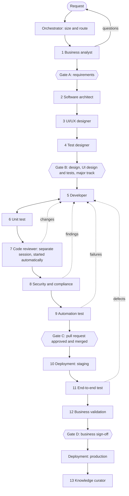

# LatticePolicy Delivery Workflow

How every coding request moves from idea to validated release, whichever AI
assistant (or person) does the work. The agents are role contracts in
[`agents/`](../../agents/README.md); their handoffs are files in a work package
under `docs/work/`. Any tool, or a person, can pick up a package from its files.

Start a request in any AI tool with:

```text
Start the LatticePolicy delivery flow for: <your request>
```

or from a terminal:

```bash
npm run flow -- start "Add mortgagee change endorsement for HO-3"
npm run flow -- next WP-0002          # prompt for the next agent, for any AI tool
npm run flow -- status WP-0002
```

## Stages



| Stage | Agent | Output in the work package |
| --- | --- | --- |
| 0 | Orchestrator | `status.json`, `status.md` |
| 1 | Business analyst | `01-requirements.md` |
| 2 | Software architect | `02-design.md` |
| 3 | UI/UX designer | `03-ui-design.md` (or "No user-facing change") |
| 4 | Test designer | `04-test-design.md` |
| 5 | Developer | code, `docs/tasks/` note, `05-implementation.md` |
| 6 | Unit test | tests, `06-unit-tests.md` |
| 7 | Code reviewer | `07-code-review.md` |
| 8 | Security and compliance | `08-security-compliance.md` |
| 9 | Automation test | `e2e/` specs, `09-automation-tests.md` |
| 10 | Deployment | `10-release.md` |
| 11 | End-to-end test | `11-e2e-results.md` |
| 12 | Business validation | `12-business-validation.md` |
| 13 | Knowledge curator | `13-lessons.md` |

`traceability.md` links each requirement to its design, code, tests, release
and validation evidence; each agent fills its column.

## Tracks

The orchestrator chooses a track and says why; the requester can override it.

| Track | Use for | Stages | Human gates |
| --- | --- | --- | --- |
| `quick` | Copy or typo fixes, a small bug with an obvious cause, test-only or docs-only changes | 0, 4, 5, 6, 9 | C |
| `standard` | A feature or behavior change inside one area | all (architect writes a short design; the UI/UX designer writes "No user-facing change" when nothing is visible) | A, C, D |
| `major` | New product line, migrations, security, tenancy, authentication, rating, filed forms, customer data, AI, or cross-module change | all, with an ADR for lasting decisions | A, B, C, D |

Anything touching tenant isolation, authentication, rating, filed forms,
customer data, migrations or AI data boundaries is **major**, whatever its size.

## Gates

| Gate | Approves | Evidence | Approver |
| --- | --- | --- | --- |
| A | Requirements | `01-requirements.md`, answered questions | Product owner |
| B | Design, UI design and test plan (major) | `02-design.md`, `03-ui-design.md`, `04-test-design.md` | Product owner or lead engineer |
| C | Merge | Pull request, review, security findings, green CI | Code owner (GitHub branch protection) |
| D | Production release | `11-e2e-results.md`, `12-business-validation.md`, `10-release.md` | Business owner (carrier business user for carrier-specific work) |

At each gate the orchestrator summarizes the handoff and **asks the approver**.
Approvals are recorded with the approver's name and their words:
`npm run flow -- approve WP-0002 A --by "<name>" --note "<what they said>"`.
An agent never records an approval nobody gave, and never approves its own work.

**Waivers.** If the request says an approval is not needed — for example
"no need to ask me to approve the requirements" — the orchestrator records a
waiver with the requester's words instead of asking:
`npm run flow -- waive WP-0002 A --by "<requester>" --note "<their words>"`.
Only Gates A and B can be waived. Gate C (merge) and Gate D (business sign-off)
always need a person. A waiver is never inferred.

**Where approvals are enforced.** Gate C is GitHub's required code-owner review.
Approvals and waivers for A, B and D are recorded in the work package's
`status.json`; `.github/CODEOWNERS` makes `docs/work/`, `agents/`,
`scripts/delivery/` and `docs/delivery/` code-owner files, so a recorded
approval reaches `main` only through the code owner's review of that change.

## Decisions (October 2026)

These were decided for LatticePolicy when the workflow was adopted and can be
revised here:

1. **Agent autonomy.** Agents may create branches, commit and open pull requests
   between gates. They stop at every gate, never merge a pull request and never
   deploy to production.
2. **Approvers.** The product owner approves Gates A, B and D; the code owner
   approves Gate C through GitHub. Carrier-specific work adds a carrier business
   user at Gate D. The orchestrator asks for requirements approval (Gate A) by
   default; the requester skips it by saying so in the request.
3. **Staging.** Use a persistent staging environment when one is configured
   (`E2E_BASE_URL`, `E2E_API_BASE_URL`); until then the local Docker stack built
   from `main` is staging. Tests never use a pilot or demo database.
4. **Knowledge refresh.** Monthly. The `knowledge-refresh` workflow opens an issue
   for files past their review date; the knowledge curator proposes sourced
   updates in a pull request that a person reviews. Security advisories are
   handled when they appear.
5. **Code review is automatic and independent.** The orchestrator starts the code
   reviewer itself as a fresh agent session, separate from the developer; the
   requester does nothing. A different model or tool is recommended, not required.
6. **Tracks** as defined above.

## Returns and loops

When an agent finds a problem in earlier work it returns the package to that
stage with a reason (`npm run flow -- return WP-0002 developer --reason "…"`).
That stage and every later stage run again, and any approval given after those
stages is reopened so the approver sees the rewritten work (waivers stated by
the requester still apply).

A stage can be returned **twice**; the **third** return stops the package as
`needs-human`. Nothing moves until a person decides and the orchestrator records
it: `npm run flow -- resolve WP-0002 --by "<name>" --note "<decision>"`.

The code reviewer's stage cannot complete while its findings table lists an
open blocker or major finding, and the security stage while it lists an open
high or critical finding.

## Pull requests

Every pull request states its work package in the description:

```text
Work package: WP-0002
```

or, for a quick change without a package:

```text
Delivery track: quick — <one-line reason>
```

The `delivery-checks` workflow fails a pull request without one, or whose work
package is missing a required gate (A, and B on the major track). Automated
dependency updates are exempt.

## Knowledge

Agents rely on [`docs/knowledge/`](../knowledge/README.md): P&C insurance,
architecture, and the project docs. Every knowledge file states its sources and
`last_reviewed` date; agents treat stale time-sensitive facts as needing
confirmation. `npm run knowledge:report` lists files due for review.

## Tool support

`npm run agents:sync` generates each tool's files from `agents/`:

| Tool | Generated files |
| --- | --- |
| Codex, Jules, Aider, and agents that read `AGENTS.md` | delivery section of `AGENTS.md` |
| Claude Code | `CLAUDE.md` (points to `AGENTS.md`), `.claude/agents/<agent>.md` (one sub-agent per role) |
| Gemini CLI | `GEMINI.md` (points to `AGENTS.md`) |
| GitHub Copilot | `.github/copilot-instructions.md`, `.github/prompts/<agent>.prompt.md` |
| Cursor | `.cursor/rules/delivery-flow.mdc` |

CI runs `npm run agents:sync -- --check` and fails when they drift.
